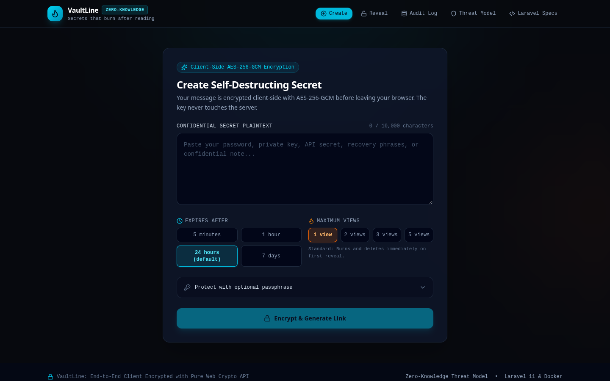
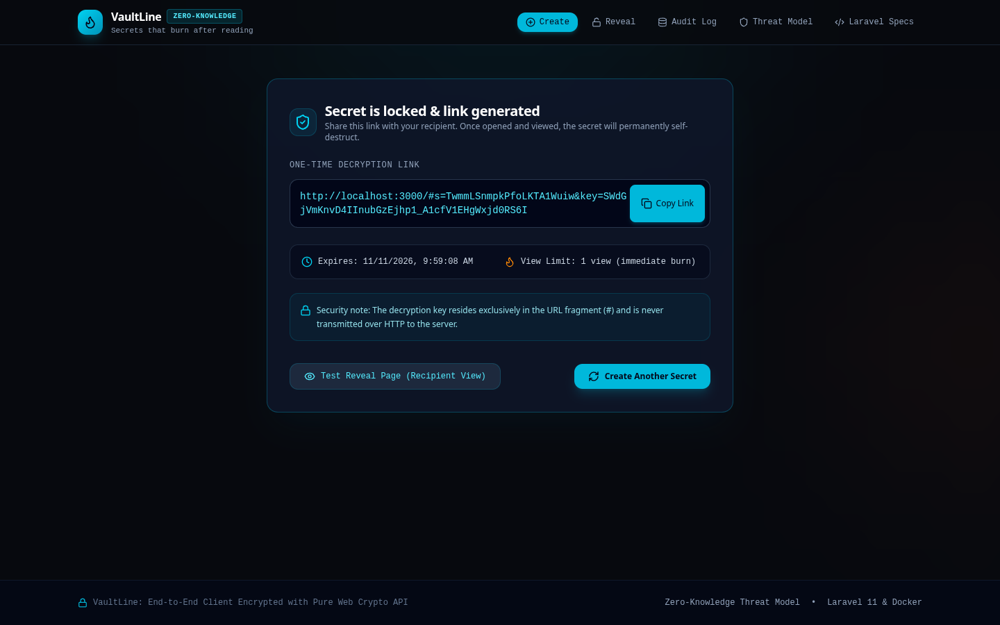
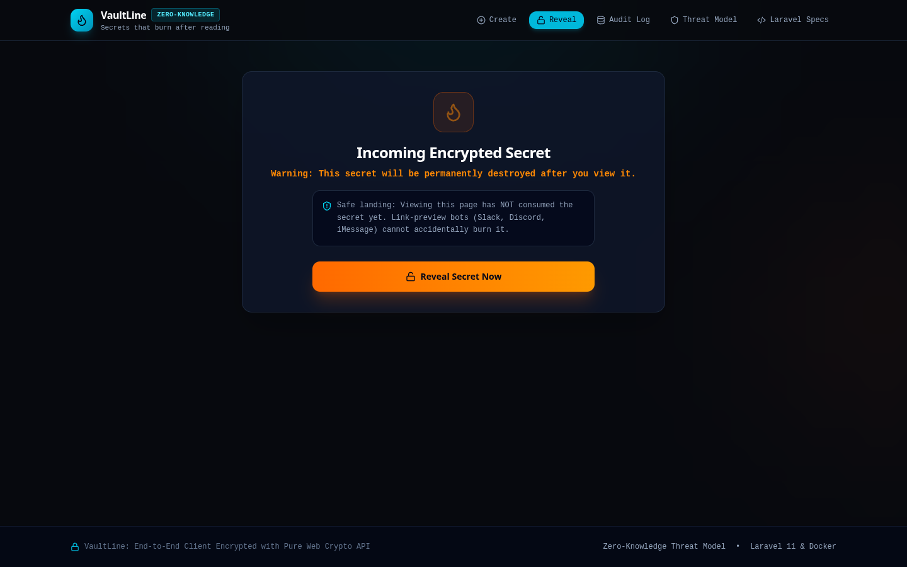
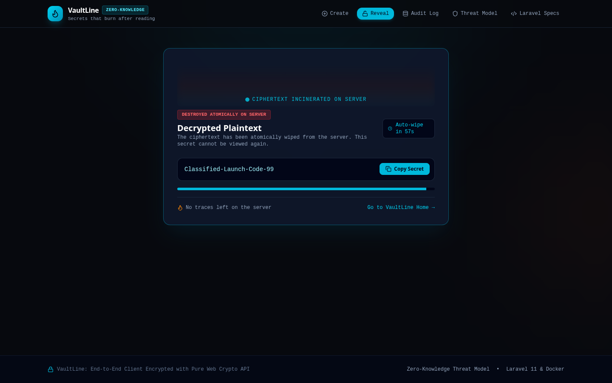
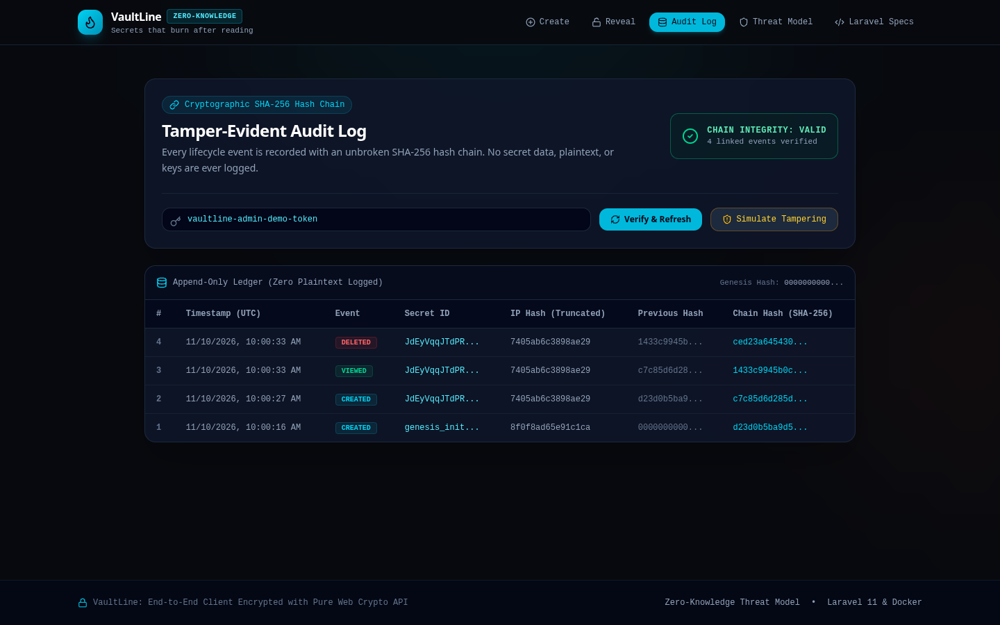
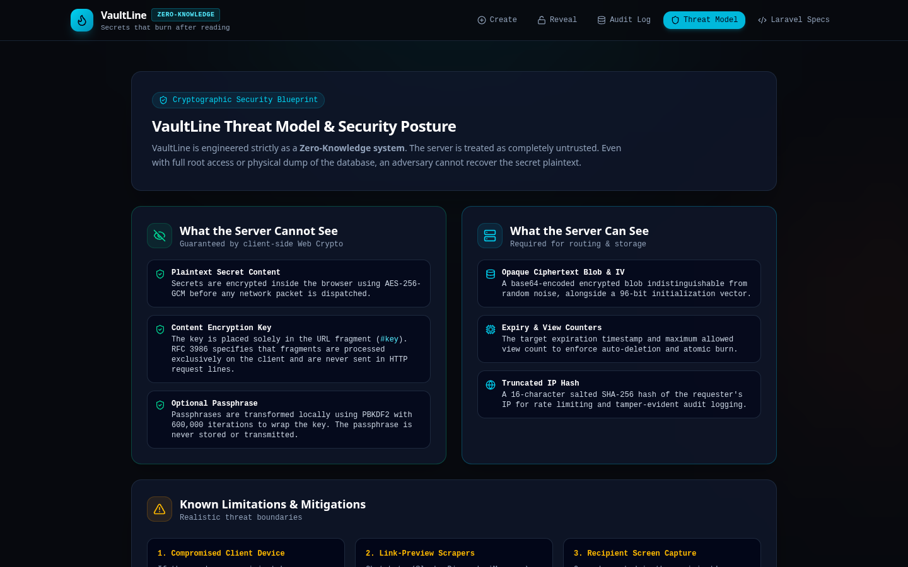
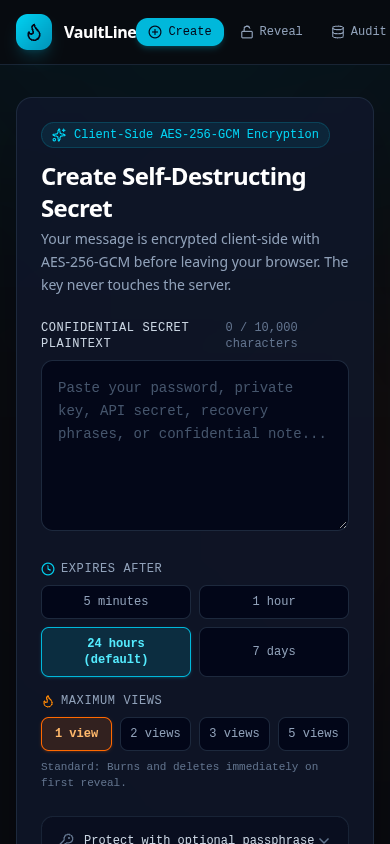
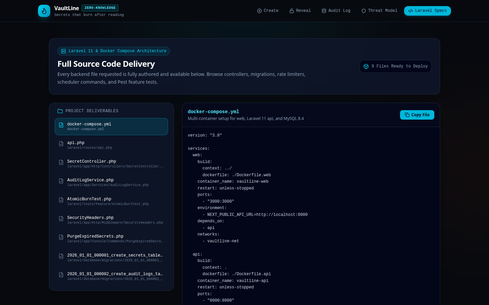

# 🔥 VaultLine

**Secrets that burn after reading.**

VaultLine is a zero-knowledge, self-destructing secret-sharing tool. Paste a password, API key or private note, get a one-time link, and send it. The recipient reads it once, then it is gone for good. The server never sees the plaintext or the key.



## How it works

1. **Encrypt in the browser.** The sender's browser generates a random 256-bit AES-GCM key and a 96-bit IV (Web Crypto API only, no third-party crypto libraries) and encrypts the secret locally.
2. **Store only ciphertext.** The server receives the ciphertext, IV and metadata (expiry, view limit). Nothing else.
3. **Key stays in the URL fragment.** The link looks like `https://host/#s={id}&key={base64url-key}`. Fragments are never sent over HTTP, so the server cannot see the key.
4. **Reveal once.** The recipient opens the link, clicks *Reveal*, the browser fetches the ciphertext and decrypts it locally. The server deletes it atomically, so two simultaneous requests can never both succeed.

| Link generated | Safe landing (bot-proof) | Revealed and destroyed |
|---|---|---|
|  |  |  |

## Features

- **Client-side AES-256-GCM** encryption; the server is treated as untrusted.
- **Atomic burn-after-read**, with 1 to 5 allowed views.
- **Expiry:** 5 minutes, 1 hour, 24 hours (default) or 7 days.
- **Optional passphrase:** PBKDF2 (SHA-256, 600,000 iterations) wraps the content key, so the link alone is not enough.
- **Safe landing page:** opening the link does not consume the secret, so Slack, Discord and iMessage link previews cannot burn it.
- **Auto-hide:** the revealed secret wipes itself from the screen after 60 seconds.
- **Tamper-evident audit log:** every event (`created`, `viewed`, `expired`, `deleted`, `failed_attempt`) is stored in a SHA-256 hash chain with no secret data. The admin view verifies the chain and reports where it breaks.
- **Hardening:** per-IP rate limiting, strict security headers (CSP, `no-referrer`, `nosniff`, frame denial, `no-store`), 128-bit random ids, input size limits, scheduled purge of expired secrets.
- **Accessible and responsive:** mobile first, keyboard friendly, `prefers-reduced-motion` respected.

| Audit log | Threat model | Mobile |
|---|---|---|
|  |  |  |

## Repository layout

This repo contains two implementations of the same API contract:

| Path | What it is |
|---|---|
| `src/`, `server.ts` | **Runnable demo.** React 19 + Vite + Tailwind frontend served by an Express server with an in-memory store. Start here. |
| `laravel/` | **Production backend.** Laravel 11 / PHP 8.3 / MySQL implementation with migrations, models, controllers, form requests, rate limiters, scheduler, security-header middleware and tests. |
| `docs/THREAT_MODEL.md` | What the server can and cannot see, and known limits. |

```
src/
├── components/        CreateSecret, RevealSecret, AuditLogView, ThreatModelView, CodebaseExplorer, BurnAnimation
├── lib/crypto.ts      AES-GCM, PBKDF2 key wrapping, base64url helpers
├── lib/api.ts         API client
├── lib/strings.ts     All UI strings in one file (easy to translate)
└── crypto.test.ts     Unit tests for the crypto helpers
server.ts              Express API, rate limiting, security headers, audit hash chain
laravel/               Laravel 11 backend (see laravel/README.md)
```

## Quick start (demo)

Requirements: Node.js 20+.

```bash
npm install
npm run dev        # http://localhost:3000
npm test           # crypto unit tests
npm run build      # production build into dist/
```

Optional environment variable:

| Variable | Default | Purpose |
|---|---|---|
| `VAULTLINE_ADMIN_TOKEN` | `vaultline-admin-demo-token` | Token for the admin audit endpoint. **Change it outside local demos.** |
| `PORT` | `3000` | Server port |

The demo stores data in memory, so everything resets when the server restarts. The audit page also has a *Simulate Tampering* button so you can watch the hash chain detect a modified entry.

## API

| Method | Endpoint | Description |
|---|---|---|
| `POST` | `/api/secrets` | Store `{ ciphertext, iv, expires_in, max_views, has_passphrase, wrapped_key?, salt? }`. Returns `{ id, expires_at }`. |
| `GET` | `/api/secrets/{id}/meta` | Existence and passphrase info. Does **not** consume a view. |
| `POST` | `/api/secrets/{id}/reveal` | Returns ciphertext and IV, and burns a view atomically. |
| `GET` | `/api/admin/audit` | Audit entries plus chain status. Requires the admin token. |

## Laravel backend

The `laravel/` folder is the production-grade version: MySQL with row locking (`lockForUpdate`) for atomic burn, `RateLimiter` per IP, a `PurgeExpiredSecrets` command on the scheduler, and Pest/PHPUnit tests including `AtomicBurnTest`. Setup with Docker Compose is in [`laravel/README.md`](laravel/README.md).



## Security notes

- The server sees only ciphertext, IV, expiry, view counters and a truncated, salted IP hash.
- The server cannot see the plaintext, the content key (it lives only in the URL fragment) or the passphrase.
- Known limits: a compromised sender or recipient device, anyone who obtains the full link before the recipient, and screen capture on the recipient side. Details and mitigations are in [`docs/THREAT_MODEL.md`](docs/THREAT_MODEL.md).

## Tech stack

React 19 · TypeScript · Vite · Tailwind CSS 4 · Motion · Express · Web Crypto API · Laravel 11 · MySQL · Docker Compose

## Author

Built by [Hossein Shahverdi](https://github.com/HosseinShahverdi).
